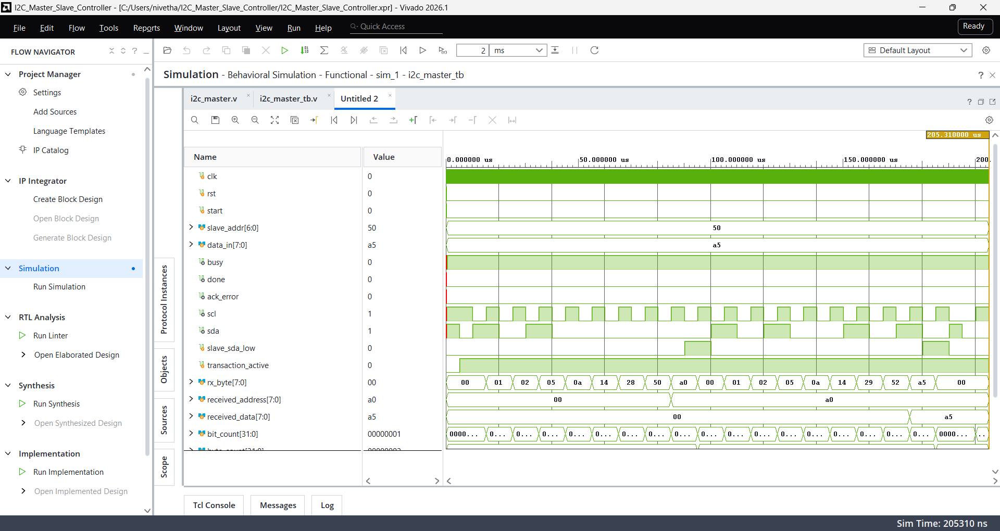

# I2C Master Controller using Verilog

## Description
This project implements an I2C master controller using Verilog HDL in Xilinx Vivado. The design performs a write operation by sending a 7-bit slave address followed by 8-bit data.

## Features
- Verilog HDL implementation
- Clock divider for SCL generation
- Start and stop condition generation
- 7-bit slave addressing
- 8-bit data transmission
- ACK detection
- Testbench with a simulated I2C slave
- Behavioral simulation in Vivado

## Files
- `i2c_master.v` – I2C master controller design
- `i2c_master_tb.v` – Testbench for simulation

## Simulation
The testbench verifies the address and data transmission using a simulated slave.

**Test case:**
- Slave address: `0x50`
- Address byte transmitted: `0xA0`
- Data transmitted: `0xA5`
- Address ACK: Received
- Data ACK: Received

**Result:** PASS

## Tools Used
- Verilog HDL
- Xilinx Vivado

## Future Improvements
- Read operation support
- Configurable clock divider
- Support for repeated START conditions
- Testing with additional addresses and data values
